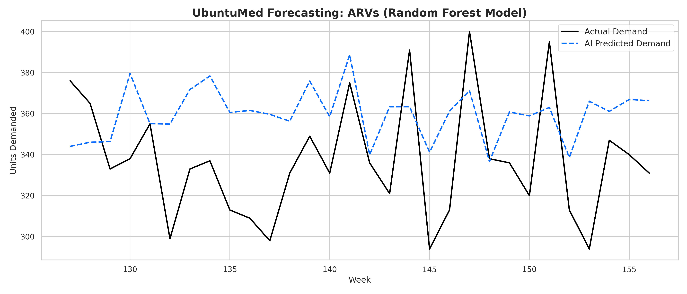
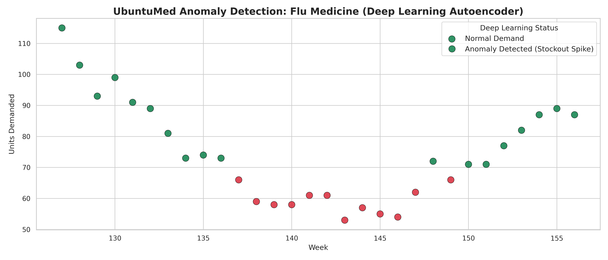
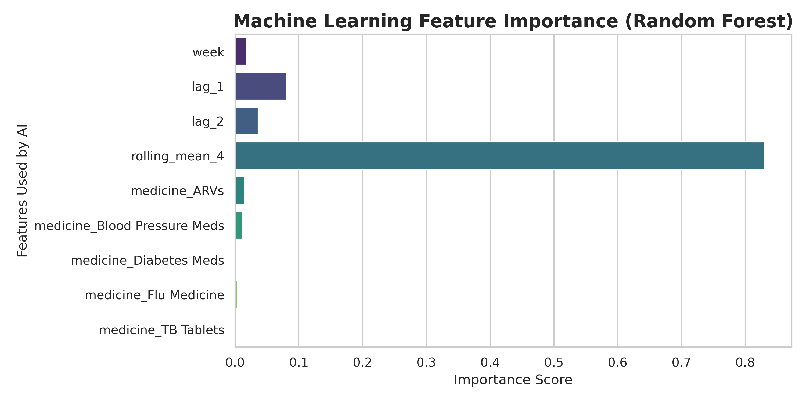

# UbuntuMed

**AI-Powered Medicine Supply & Expiry Prediction for South African Public Clinics**

> _"Ubuntu" — I am because we are. Better medicine availability for all._

[](https://www.python.org/)
[](https://fastapi.tiangolo.com/)
[](https://flask.palletsprojects.com/)
[](https://tensorflow.org/)

## Overview

UbuntuMed is an intelligent, predictive layer designed to sit on top of existing health infrastructure (like SVS and RxSolution). It helps public clinics and private pharmacies:

- **Forecast** medicine demand using Time-Series Machine Learning.
- **Warn** staff about impending stockouts and expiry risks.
- **Recommend** optimal redistribution of stock between nearby facilities.
- **Answer** natural-language questions via an NLP Chatbot.

## The Problem

South Africa's public health system faces chronic medicine shortages and wastage. According to Mabizela et al. (2023) in KwaZulu-Natal:

- **85.6%** of medicines were affected by stockouts.
- **50.6%** of clinics experienced overstocking.
- **15.2%** of medicines were wasted due to expiry.

## Machine Learning Models

UbuntuMed utilizes a hybrid AI approach:

1. **Demand Forecasting (Random Forest Regressor):** Uses historical lag features and 4-week rolling averages to predict future demand.
   - _Performance:_ **MAPE of 11.01%** (Highly accurate).
2. **Anomaly Detection (Isolation Forest & Deep Learning):** A TensorFlow Autoencoder detects unusual consumption spikes (e.g., stockout panic or theft) by analyzing reconstruction error.
3. **NLP Chatbot (TF-IDF + Logistic Regression):** Classifies user intents (e.g., "check stock", "check expiry") achieving **96% accuracy**.

## Visual Results

### 1. Forecasting Accuracy

_The Random Forest predictions (blue) closely track the actual demand (black)._


### 2. Anomaly Detection

_The Deep Learning Autoencoder successfully identifies anomalous spikes in demand._


### 3. AI Feature Importance

_Our model correctly learns that `lag_1` (last week's demand) and `rolling_mean_4` are the strongest predictors of future demand._


## Data Strategy

We utilized a hybrid data strategy to ensure our AI learns realistic South African conditions without breaching patient privacy:

- **District Health Barometer (DHB):** Real district-level medicine availability indicators.
- **Zenodo PLMIF Dataset:** Macroeconomic supply-chain risk scores (e.g., port delays).
- **Synthetic South African Dataset:** We generated 3 years of operational dispensing data, calibrated using the real stockout statistics from the KZN study and DHB availability rates, fully POPIA compliant.

## System Architecture

The application uses a modern 3-tier architecture:

- **Frontend:** Flask (HTML/CSS/JS) with Chart.js and Bootstrap.
- **Backend:** FastAPI (Python), serving 5 REST API endpoints (`/stock`, `/forecast`, `/anomaly`, `/chatbot`, `/health`).
- **Database:** PostgreSQL hosted on Supabase.
- **Deployment:** Render (Backend & Frontend).

## Repository Structure

```text
ubuntumed/
├── backend/            # FastAPI application
│   ├── app/
│   │   ├── api/        # REST endpoints
│   │   ├── core/       # Database & config
│   │   ├── models/     # SQLAlchemy models
│   │   └── ml/         # Model loading (pkl)
│   └── requirements.txt
├── frontend/           # Flask dashboard
│   ├── static/         # CSS, JS, and Images (Logo)
│   ├── templates/      # HTML files
│   └── app.py
├── ChatBot/            # NLP training scripts & datasets
├── data/               # Data storage
│   ├── raw/            # DHB & Zenodo source files
│   ├── processed/      # Cleaned CSV data
│   └── plots/          # Generated evaluation charts
├── docs/               # Project documentation & images
├── ml_training/        # Colab Notebook & ML Models
│   ├── Medicine_Demand_ML.ipynb
│   └── saved_models/   # .pkl and .keras files
├── generate_data.py    # Synthetic data calibration script
└── migrate_data.py     # Script to push CSV to Supabase
```

## Getting Started (Local Development)

### 1. Backend (FastAPI)

```bash
cd backend
python -m venv .venv
# On Windows: .venv\Scripts\activate
# On Mac/Linux: source .venv/bin/activate
pip install -r requirements.txt
uvicorn app.main:app --reload --reload-dir app
```

_API Docs available at `http://127.0.0.1:8000/docs`_

### 2. Frontend (Flask)

```bash
cd frontend
# Ensure the virtual environment is activated
python app.py
```

_Dashboard available at `http://127.0.0.1:5000`_

## Live Deployment

- **Dashboard:** [ubuntumed-dashboard.onrender.com](https://ubuntumed-dashboard.onrender.com/)
- **Backend API:** [ubuntumed-api.onrender.com/docs](https://ubuntumed-api.onrender.com/docs)
- **Database:** Supabase (PostgreSQL)

## Team

- **M Mokgadi** (Project Manager & Lead Developer)
- **KV Likethe**
- **K Mokgothu**
- **K Tabudi**
- **C Seabela**
- **L Tsotetsi**
- **WK Mohlaka**

## References

- Mabizela, S., Nakambale, H.N., & Bangalee, V. (2023). _Predictors of medicine redistribution at public healthcare facilities in King Cetshwayo District, KwaZulu-Natal, South Africa_. BMC Health Services Research.
- Health Systems Trust. (2020). _District Health Barometer 2018/19_.
